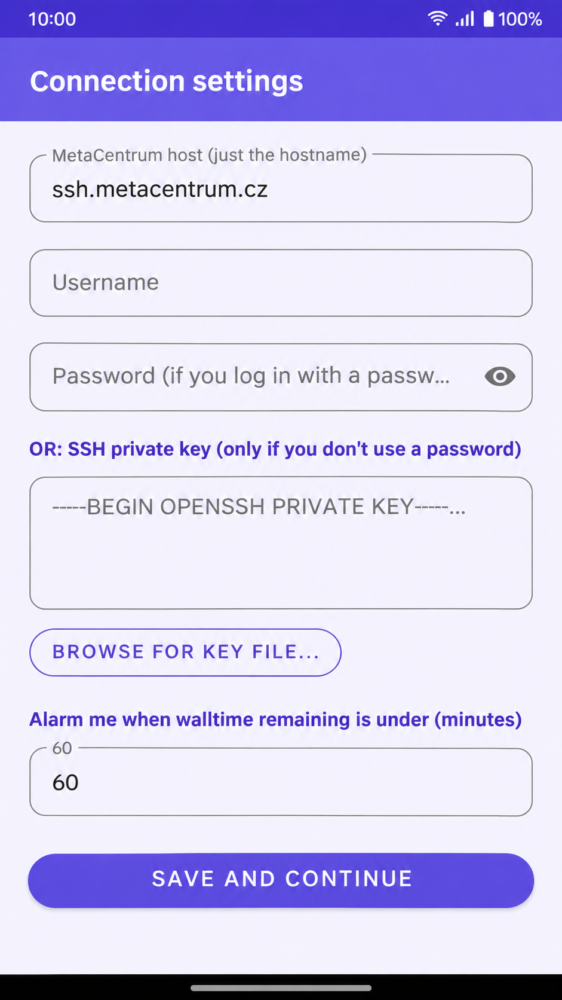
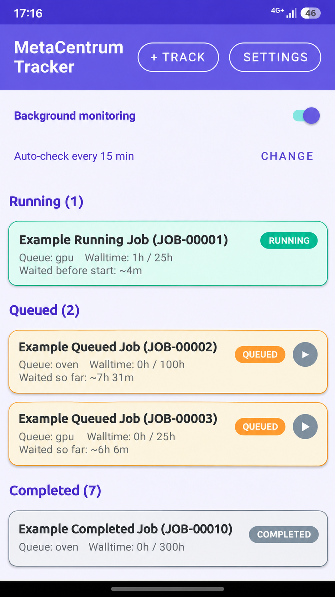
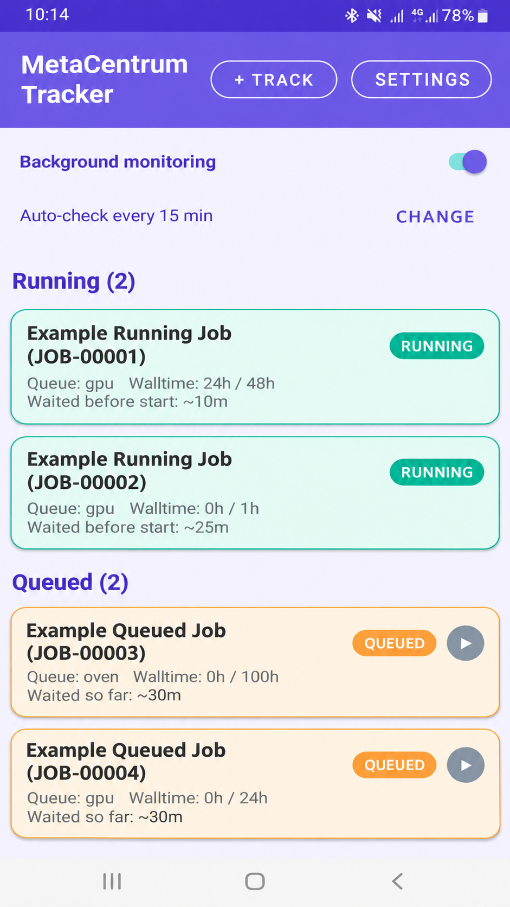

# MetaCentrum Tracker — Application Screenshots

These screenshots illustrate the application's interface.
Job names and IDs have been replaced with example values.

## 1. Connection Settings

Configure the SSH host, authentication method, and walltime alert.

## 2. Job Monitoring Dashboard

View running, queued, and completed PBS jobs.

## 3. Example Running and Queued Jobs

Monitor job status, queue information, walltime, and waiting time.

